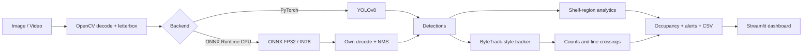

<div align="center">

# 🛒 ShelfSight Edge

**Retail shelf monitoring on a plain CPU: detect products, track them in video, and estimate shelf occupancy.**


[](https://github.com/YOUR-USERNAME/shelfsight-edge/actions)

</div>


> **Honest status.** The full pipeline, dashboard and test suite work. The bundled model is a general-purpose **COCO-pretrained YOLOv8n**, which does **not** recognise packaged grocery products yet; fine-tuning on shelf data (e.g. SKU-110K or your own photos) is the next step. All benchmark and accuracy cells below read **Not measured** until measured on real data and hardware.
>
> **Shelf occupancy is an estimate** of visible product coverage, not an audited inventory count.

## Why this project
Store cameras and edge boxes rarely have a GPU. ShelfSight Edge is built to run, be measured and be deployed on an ordinary laptop CPU, and it is strict about not claiming performance it has not measured.

## Features
- **Detection** with two interchangeable backends: PyTorch and ONNX Runtime (CPU), behind one interface.
- **Tracking** with a ByteTrack-style tracker (own implementation) and virtual-line crossing counts.
- **Shelf regions**: split a shelf into rectangles, get per-region counts, estimated occupancy and low-occupancy alerts, exported as timestamped CSV.
- **Honest counting**: detections per frame, unique tracks and line crossings are reported separately, never mixed up.
- **ONNX export and static INT8 quantization** scripts (calibration on training images only).
- **Reproducible benchmarks**: median/p95 latency, throughput, memory, CPU/OS/library versions and model hash are recorded in every result file.
- **Evaluation**: mAP50, mAP50-95, precision, recall and object-count error, cross-checked against Ultralytics' AP implementation.
- **Dataset tooling**: annotation validation, YOLO conversion, statistics, and leak-free train/val/test splits using perceptual hashing.
- **Streamlit dashboard** with six tabs, and a CPU-only Docker image (ONNX Runtime).

## Screenshots
| Image detection | Video analytics |
|---|---|
|  |  |
| **Shelf monitoring** | **Benchmarking** |
|  |  |

*Screenshots use sample photos and a composite demo image with the COCO-pretrained model. They show the pipeline working, not accuracy on grocery products.*

## How it works

More detail: [docs/ARCHITECTURE.md](docs/ARCHITECTURE.md).

## Quick start
Requires Python 3.11 or 3.12. No GPU needed.

```bash
git clone https://github.com/YOUR-USERNAME/shelfsight-edge.git
cd shelfsight-edge
python -m venv .venv
# Windows: .venv\Scripts\Activate.ps1      Linux/macOS: source .venv/bin/activate
pip install -r requirements-dev.txt
pip install -e . --no-deps
python scripts/check_env.py
pytest
```

Baseline detector (PyTorch, export and training tools; the dashboard itself runs on ONNX Runtime alone):
```bash
pip install torch==2.14.1 torchvision==0.29.1 --index-url https://download.pytorch.org/whl/cpu
pip install -r requirements-torch.txt
pip install ultralytics==8.4.185 --no-deps
python scripts/download_weights.py                    # explicit ~6 MB download into models/
python scripts/export_onnx.py --weights models/yolov8n.pt --check-image your_photo.jpg
streamlit run app/streamlit_app.py
```
In the sidebar choose a model from `models/` and press **Load model**. Nothing is loaded or downloaded automatically.

## Command-line tools
| Task | Command |
|---|---|
| Detect on one image | `python scripts/detect.py --image img.jpg --model models/yolov8n.onnx` |
| Process a video | `python scripts/process_video.py --video clip.mp4 --model models/yolov8n.onnx --out out.mp4 --stride 2` |
| Prepare a dataset | `python scripts/prepare_dataset.py --help` (validate, stats, visualize, convert, split, verify-splits) |
| Train (CPU smoke / GPU) | `python scripts/train.py --data data/yolo/dataset.yaml --smoke --device cpu` |
| Export to ONNX | `python scripts/export_onnx.py --weights models/best.pt --check-image img.jpg` |
| Quantize to INT8 | `python scripts/quantize.py --model models/best.onnx --calib-dir data/yolo/images/train --out models/best_int8.onnx --exclude-head` |
| Evaluate | `python scripts/evaluate.py --model models/best.onnx --images <test/images> --labels <test/labels> --out reports/benchmarks/onnx_fp32_eval.json` |
| Benchmark one model | `python scripts/benchmark.py --model models/best.onnx --images <test/images> --threads 2 --out reports/benchmarks/onnx_fp32.json` |
| Build comparison table | `python scripts/make_report.py` |

## Train on your own data
1. Prepare data: [docs/DATASETS.md](docs/DATASETS.md) (SKU-110K notes and a custom-dataset workflow).
2. Train on a free Colab GPU with [notebooks/train_colab.ipynb](notebooks/train_colab.ipynb), then download `best.pt`.
3. Export, evaluate and benchmark on your CPU, and fill in [docs/EVALUATION.md](docs/EVALUATION.md).

## Results
| Model | mAP50 | mAP50-95 | Median ms | p95 ms | Size MB |
|---|---|---|---|---|---|
| Pretrained YOLOv8n (class-agnostic) | Not measured | Not measured | Not measured | Not measured | Not measured |
| Fine-tuned PyTorch | Not measured | Not measured | Not measured | Not measured | Not measured |
| ONNX FP32 | Not measured | Not measured | Not measured | Not measured | Not measured |
| ONNX INT8 | Not measured | Not measured | Not measured | Not measured | Not measured |

## Engineering findings (single test image, not benchmarks)
- **Input geometry matters.** Default PyTorch inference pads to a minimal rectangle while the static ONNX model needs a square. They disagreed on a borderline detection until the PyTorch backend used square letterboxing; scores then matched to three decimals.
- **INT8 is not automatic.** Quantizing the whole YOLOv8n graph returned zero detections on a test image; keeping the Detect head in FP32 recovered them. Accuracy and speed on real data: not measured.
- **A library side effect broke validation.** Importing Ultralytics patches `PIL.Image.open`, changing the exception for corrupt images; the validators now handle it, with a regression test.

Details and protocol: [docs/EVALUATION.md](docs/EVALUATION.md).

## Project structure
```
app/            Streamlit dashboard
configs/        default, dataset, benchmark and example shelf-region configs
docs/           architecture, datasets, evaluation, limitations, licenses, interview notes
notebooks/      Colab training notebook
scripts/        command-line tools
src/shelfsight/ inference, tracking, analytics, video, evaluation, data
tests/          pytest suite
```

## Testing and quality
```bash
pytest -m "not integration"     # unit tests, no model download needed
pytest                          # also runs real-model checks if weights are present
ruff check . && ruff format --check .
```

## Docker (CPU, ONNX Runtime only)
```bash
docker build -t shelfsight-edge .
docker run --rm -p 8501:8501 -v "$(pwd)/models:/app/models" -v "$(pwd)/reports:/app/reports" shelfsight-edge
```
The Dockerfile is written but has not been built or run by the author yet.

## Limitations
Occupancy is an estimate affected by occlusion, perspective and camera angle; the tracker is not validated on MOT benchmarks; the ONNX model has a fixed 640x640 input; measured CPU latency on a low-power laptop is far from real-time. Full list: [docs/LIMITATIONS.md](docs/LIMITATIONS.md).

## Licenses
Code: MIT ([LICENSE](LICENSE)). Ultralytics (AGPL-3.0) and the SKU-110K dataset (academic, non-commercial) keep their own terms; datasets and weights are not included in this repository. See [docs/LICENSES.md](docs/LICENSES.md).

## Author
**Your Name** · [GitHub](https://github.com/karan-singh-yadav) · [LinkedIn](https://www.linkedin.com/in/karan-singh-yadav-935b36307/)