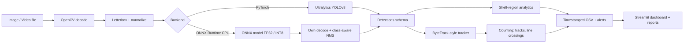

# Architecture

## Module map (`src/shelfsight/`)
| Module | Responsibility |
|---|---|
| `inference/base.py` | `Detections` schema, `Detector` interface, image validation/loading |
| `inference/postprocess.py` | letterbox, preprocess, NMS, YOLOv8 output decode (used by ONNX backend) |
| `inference/{pytorch,onnx}_backend.py` | the two interchangeable backends; `factory.py` selects one |
| `tracking/tracker.py` | Kalman + two-stage IoU association (ByteTrack-style) |
| `analytics/` | counting semantics, shelf regions + occupancy, CSV/history reporting |
| `video/processor.py` | streaming decode -> detect -> track -> analytics -> render -> write |
| `evaluation/` | metrics (mAP etc.), evaluator, benchmark, failure analysis |
| `data/` | validation, YOLO conversion, stats, leak-free splits, synthetic fixture |

## Key decisions
* **One `Detections` schema.** Everything downstream is backend-agnostic, so switching PyTorch/ONNX needs no logic changes.
* **Own YOLOv8 decode + NMS for ONNX.** Keeps the ONNX path dependency-light (no torch needed to run the app) and lets stage timings be measured separately. It was verified to reproduce PyTorch scores exactly on one test image (see EVALUATION.md).
* **Static-shape ONNX export (640x640).** Simplest and fastest on CPU; the PyTorch backend therefore uses square letterboxing (`rect=False`) so both see identical inputs.
* **Own tracker** (published algorithm, no AGPL code, one extra dependency: SciPy).
* **No implicit downloads/loads.** Weights come from an explicit script; the dashboard loads a model only on a button press.

## Counting semantics (never interchangeable)
1. **Detections per frame**: a snapshot of detector output.
2. **Unique tracks**: distinct confirmed track IDs. ID switches and gaps longer than the track buffer inflate it; a missed association splits one product into two tracks.
3. **Estimated unique products passing through**: virtual-line crossing count, meaningful only for flow scenes (conveyor, moving basket). An estimate, not an audited count.

For a static shelf, (1) is the useful number; (2) and (3) describe motion.

## FPS definitions
`end_to_end_fps` = processed frames / wall time including decode, detect, track, analytics, render and write. `detect_only_fps` = processed frames / time inside `detector.predict` (preprocess + inference + postprocess). Benchmark `throughput_fps` = timed runs / sum of `predict` wall time, batch 1, excluding image decode.
